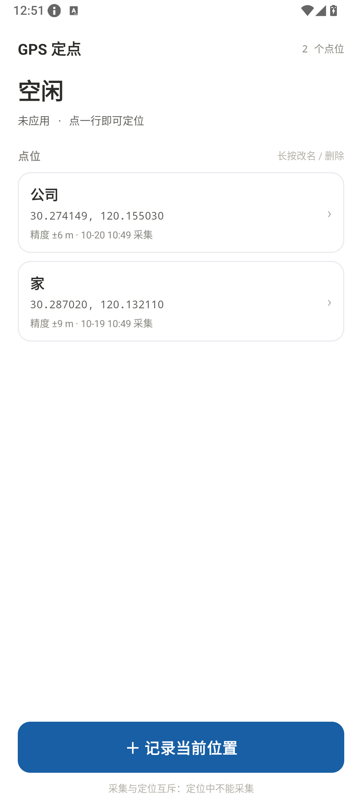
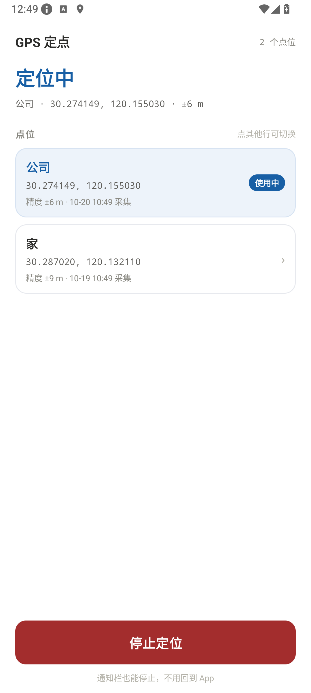
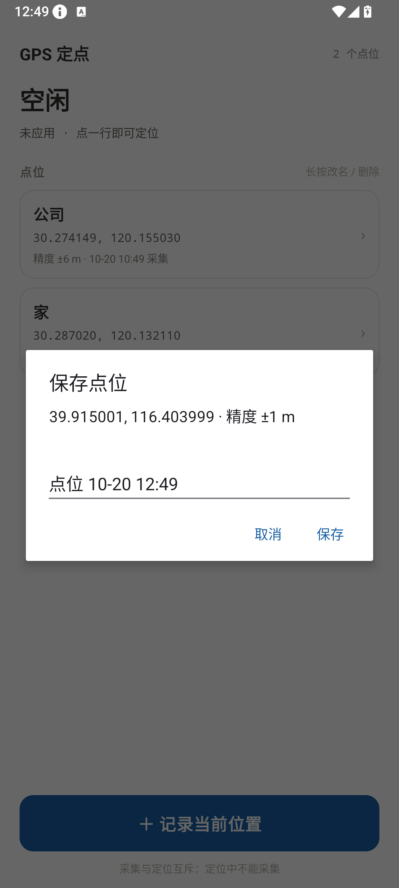
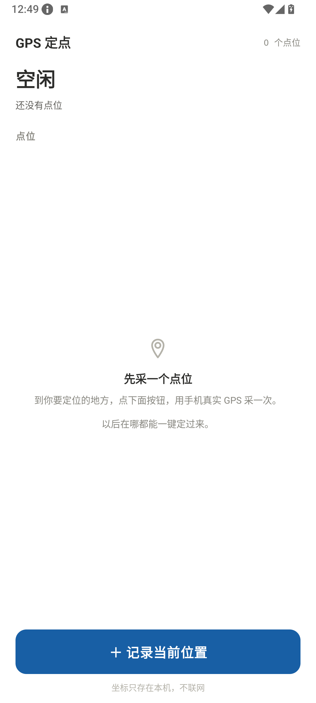
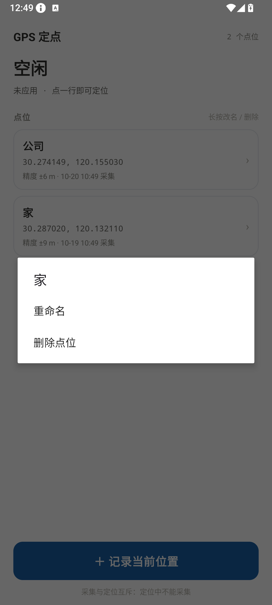
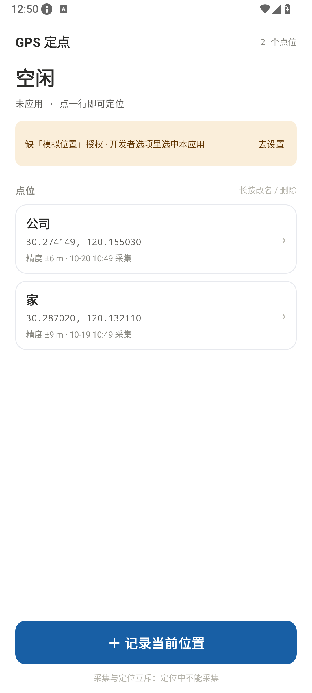

# GPS 定点（GpsPoint）

Android 端的定点虚拟定位工具，是 `D:\gr\code3\GpsRoam` 的**简化版**。

**只做一件事：提前用手机采一个真实定位点，需要时一键把手机定位定到那儿。**
采点、点名、点一行 → 完事。没有地图、没有路线、没有轨迹录制回放、没有倍速、没有摇杆。

> 用途：自己测试定位类应用 / 在不暴露真实位置时出示一个固定地点。不做分发，数据不出本机（**没有 INTERNET 权限**）。

---

## 一、界面

**只有一个界面。** 设计文档与高保真原型见 [`UI设计.md`](UI设计.md)、[`ui-prototype/index.html`](ui-prototype/index.html)。

| 状态 | 状态名 | 主按钮 | 列表 |
|---|---|---|---|
| 空闲 · 无点位 | 空闲（墨色） | ＋ 记录当前位置 | 空态说明 |
| 空闲 · 有点位 | 空闲（墨色） | ＋ 记录当前位置 | 点一行 = 立刻定位过去 |
| 采集中 | 空闲（墨色） | 记录当前位置（禁用） | 状态行变「正在取定位…」 |
| 定位中 | 定位中（蓝） | 停止定位（红） | 使用中的行高亮，点其他行 = 切换 |

- 主按钮尺寸与位置**永远不变**（58dp，贴底），只有文案和颜色换。
- 权限条只在缺权限时出现；列表为空时「长按改名 / 删除」提示隐藏。
- 长按点位：重命名 / 删除（删除需二次确认）。
- 定位中可在**通知栏**直接停止，不用回到 App。
- 锁定竖屏（手机工具），转屏不会打断采集；分屏改尺寸也不会重建界面。

| 空闲 · 有点位 | 定位中 | 采集 · 命名 |
|---|---|---|
|  |  |  |

| 空态 | 长按菜单 | 缺权限 |
|---|---|---|
|  |  |  |

通知栏（含「停止」）：[`screenshots/06_notification.png`](screenshots/06_notification.png)。
以上全部是 Android 14 模拟器实拍，不是设计稿。

---

## 二、两个动作，互斥

| 动作 | 做什么 |
|---|---|
| **采集** | 向系统要真实 GPS fix（最长 15 秒），**取这段时间里最准的一次**，命名后存本地 |
| **应用** | 注册名为 `gps` 的测试 Provider，以 1Hz 把坐标写进系统定位，直到手动停止 |

**采集为什么不是「拿到第一个就存」**：冷启动第一个 fix 常有几十米误差，几秒内会迅速变准。
所以精度好到 ±12 m 立刻收，否则再听 3 秒取最优；超过 ±100 m 的 fix 宁可提示失败也不存。
等待期间状态行实时显示当前精度（`正在取定位… ±23 m`）。

**为什么互斥**：注入顶掉真实 GPS 之后，再去采集只会采到自己写进去的假坐标。
所以定位中主按钮直接变成「停止定位」，不提供采集入口；采集过程中点列表只提示等一等。

**为什么是 1Hz**：只写一次的 fix 过一会儿就会被当成过期数据。持续上报才叫「一直定在那儿」。

---

## 三、能覆盖到什么程度（先说清楚）

**✅ 系统定位层 —— 能覆盖。**
注入层复用 `gps` Provider 名字，`dumpsys location` 会显示 `gps provider [mock]`，
任何走 `LocationManager` / 融合定位取位置的应用读到的都是这个坐标。

**⚠️ 只调 API 拿位置的普通应用 —— 骗得过。**

**❌ 检测得深的 —— 骗不过，也不打算骗：**

1. 系统会给模拟位置打标记，`Location.isFromMockProvider()` 一句就能识破。金融、支付、网约车类基本都查。
2. 运动类 App 还会读加速度计、陀螺仪、计步器。人坐着不动、定位却在别处，传感器数据对不上 ——
   Android 没有任何伪造传感器的公开 API，也不是权限问题，本项目不做。
3. 少数应用用自研 SDK 直连基站 / WiFi，不走系统 Provider。

**采集的坐标是 WGS-84**（手机 GPS 与系统定位用的就是它），全链路不做任何坐标系转换。
如果你从高德（GCJ-02）或百度（BD-09）复制坐标过来用，在中国境内会偏几百米 —— 本版没有手动输入坐标，不做这件事。

---

## 四、跑起来

### 1. 编译

本机环境（与 `code3` 一致，实测可用）：Android SDK `C:\Users\15257\AppData\Local\Android\Sdk`（platform 34 / build-tools 34.0.0）、
JDK 17+（用 `D:\gr\android\jbr`，OpenJDK 21）、Gradle 8.5（本地发行版）。工程：AGP 8.2.2 / Kotlin 1.9.22 / minSdk 26 / targetSdk 34。

```powershell
$env:JAVA_HOME = "D:\gr\android\jbr"
& "C:\Users\15257\.gradle\wrapper\dists\gradle-8.5-bin\5hry6tgzq0wontdz18qo6fdj9\gradle-8.5\bin\gradle.bat" `
  --project-dir "D:\gr\code3.1\GpsPoint" assembleDebug --console=plain
```

产物：`app/build/outputs/apk/debug/app-debug.apk`。
已另外复制一份到工程外，方便直接装：`D:\gr\code3.1\GpsPoint-v1.1.apk`（同一文件，debug 签名）。

> 这是 **debug 签名**包，本机自用可以直接装；要分发/上架得自己生成 release 签名。
> 也可以用 Android Studio 直接打开 `D:\gr\code3.1\GpsPoint`（仓库里没有 `gradle-wrapper.jar`，提示 wrapper 缺失时选本地 Gradle 即可）。

### 2. 授权（两步，缺一不可）

1. **精确定位**：首次采集/定位时系统弹窗，选允许。
   （Android 13+ 还会要**通知权限**，不给只是看不到常驻通知，服务照常跑。）
2. **模拟位置**（只影响「应用」，不影响「采集」）：
   **设置 → 关于手机 → 连点「版本号」7 次** 开发者选项 → **选择模拟位置信息应用 → 选中「GPS 定点」**。

> ⚠️ **重装 App、重启手机后「模拟位置」授权都会失效**，要重新选一次。权限条会提示你。
> ⚠️ v1.1 起 Manifest 里声明了 `ACCESS_MOCK_LOCATION`：不声明的话，这个候选列表根本不会出现本应用。

### 3. 荣耀 / 华为（MagicOS / EMUI）特别注意

华为 HarmonyOS 5+ 已经把「选择模拟位置信息应用」整项移除了（[华为官方说明](https://consumer.huawei.com/cn/support/content/zh-cn16071458/)），
那种机器只能用 ADB 授权，或者干脆不行。**荣耀是 Android 的 MagicOS，仍然有这个选项**，但位置和保活设置都有坑：

**装 APK**

1. 关「纯净模式」：设置里搜 **纯净模式** → 退出（MagicOS 一般在 设置 → 安全 → 更多安全设置）。
2. 允许安装：设置里搜 **安装外部来源应用** → 选你用的文件管理器 / 浏览器 → 允许。
3. 安装时提示风险就选「继续安装」。

**开「模拟位置」授权**

1. 设置 → 关于手机 → 连点 **版本号** 7 次（可能要输锁屏密码）→ 开发者选项。
2. 设置 → 系统和更新 → 开发者选项 → 找 **「ADB 调试」下方**的「选择模拟位置应用」。
   （荣耀官方口径：该选项在 ADB 调试下方；不同 MagicOS 版本位置略有差异，设置里直接搜「模拟位置」更快。）
3. 列表里选「GPS 定点」。

**列表里没有它，或者系统把这个选项藏了** → 用电脑 ADB 直接授权，等效于在列表里选中：

```powershell
adb shell appops set com.gpspoint android:mock_location allow
adb shell appops get com.gpspoint android:mock_location   # 应输出 mock_location: allow
```

需要先在开发者选项里打开「USB 调试」，手机连电脑后点「允许调试」。
（注意：**v1.0 的包没有声明 `ACCESS_MOCK_LOCATION`，可能不会出现在列表里；请用 v1.1**。）

**保活（不设会在后台被清掉，定位悄悄失效）**

- 设置 → 应用和服务 → **应用启动管理** → 「GPS 定点」→ 关掉「自动管理」→ 手动管理里
  **自启动 / 关联启动 / 后台活动** 全开。
- 设置 → 电池 → **应用耗电管理** → 「GPS 定点」→ 允许后台活动（或设为「不限制」）。
- 最近任务里把这个 App 的卡片**下拉加锁**。
- 通知：设置 → 通知和状态栏 → GPS 定点 → 允许通知（Android 13+ 首次应用时也会弹）。

**权限**

- 位置：设置 → 隐私 → 权限管理 → 位置信息 → GPS 定点 → 「仅使用期间允许」+ 打开「精确位置」。

> 荣耀社区有 MagicOS 9 升级后模拟位置失效的反馈（[帖子](https://club-api.c.hihonor.com/thread-29806049-1-1.html)）。
> 遇到时先用上面的 `appops get` 确认授权还在，再检查是不是被后台清理了。

### 3. 第一次这么测

1. 到空旷处（室内、地下车库收不到 GPS），点「＋ 记录当前位置」；
2. 取到定位后起个名字保存，列表里就多一条；
3. 点这一行 → 状态变「定位中」，`dumpsys location` 里能看到 `gps provider [mock]`；
4. 点其他行可以直接切换点位（Provider 不重建，不闪回真实位置）；
5. 点「停止定位」或通知栏的「停止」，GPS 交还系统。

---

## 五、实测记录（2026-10-20，Android 14 x86_64 模拟器）

| 验证项 | 结果 |
|---|---|
| 编译 | ✅ `assembleDebug` 通过，debug APK 约 6 MB（未混淆） |
| 采集 | ✅ 点按钮 → 系统 GPS fix → 命名弹窗（坐标 + 精度预填）→ 存进 `shared_prefs/points.xml` |
| 采集取最优 | ✅ 模拟器精度恒为 ±1 m，走「够准立刻收」分支；`±12 m` 阈值、3 秒 settle 窗、`±100 m` 拒绝线在代码里 |
| 应用 | ✅ `dumpsys location` 显示 `gps provider [mock]`，坐标 1Hz 刷新（每秒一条 `received location`） |
| 速度/航向 | ✅ `vel=0.0 bear=0.0`，定点就该是站着不动的样子；精度取采集值（钳到 3~50 m） |
| 切换点位 | ✅ 点另一行坐标立刻变，**没有新增 `added mock provider override`**（Provider 未重建） |
| 通知栏停止 | ✅ 撤掉 mock override，界面回到「空闲」 |
| 长按菜单 | ✅ 重命名（写回存储）、删除（二次确认后删掉） |
| 状态恢复 | ✅ 按 Home 再回到 App，仍显示「定位中」和当前点位 |
| 转屏 | ✅ 锁定竖屏；转屏/分屏改尺寸都不重建界面，不打断采集 |
| 缺权限 | ✅ 撤掉 mock 授权后黄条出现，文案与「去设置」正确 |
| 去设置引导 | ✅ 开发者选项未开时送到「关于手机」并提示连点版本号 7 次（模拟器实测） |

> 模拟器上 `adb emu geo fix` 没有生效（采集到的始终是模拟器默认坐标），
> 所以「两个不同点位」是直接写 `shared_prefs/points.xml` 造的数据；
> **采集链路本身已按真实流程跑通**（真机上 fix 由 GPS 提供）。

---

## 六、代码结构

```
app/src/main/java/com/gpspoint/
├─ MainActivity.kt              唯一界面：状态渲染、采集、应用、长按菜单、权限
├─ data/
│   ├─ SavedPoint.kt            点位模型（WGS-84）
│   └─ PointStore.kt            点位落盘（SharedPreferences 里的一个 JSON 数组）
├─ locate/
│   └─ RealLocationFetcher.kt   一次真实定位采集（GPS 优先、超时必失败、不拿缓存凑数）
├─ mock/
│   ├─ MockPermission.kt        「模拟位置」授权检测（AppOps）
│   └─ MockLocationInjector.kt  注入层：注册 gps 测试 Provider + 写坐标
└─ service/
    └─ PointService.kt          前台服务：1Hz 心跳 + 常驻通知（含「停止」）
```

**为什么点位用 SharedPreferences**：手工采的，最多几十条，一个 JSON 数组读写毫无压力，不用上 Room。
**为什么没有引擎层**：定点没有插值、没有时间轴、没有倍速 —— 一个 1Hz 定时器足够。

UI 资源：

```
app/src/main/res/
├─ layout/activity_main.xml     单屏：状态 + 权限条 + 列表 + 主按钮
├─ layout/item_point.xml        点位行（名字 / 坐标 / 精度与时间 / 使用中）
├─ drawable/bg_point_row*.xml   卡片与「使用中」两种底
├─ values/{colors,strings,themes}.xml
└─ mipmap-anydpi-v26/ic_launcher*.xml   自适应图标（白图钉 + 主色底）
```

---

## 七、常见问题

**Q：点「记录当前位置」提示「没收到定位，到空旷处再试」**
本版**只用新 fix**，不拿系统缓存坐标凑数（缓存可能是几小时前，甚至是我们自己刚注入的假点）。
到室外、确认系统定位开关打开再试。最长等 15 秒。

**Q：点了点位没反应 / 提示没授权**
「模拟位置」授权没给。开发者选项 → 选择模拟位置信息应用。**重装、重启后都要重选。**
开发者选项本身还没打开时，App 会把你送到「关于手机」并提示连点「版本号」7 次，开完再回来点「去设置」。

**Q：别的 App 还是显示真实位置**
1. 金融、支付、网约车类会查 `isFromMockProvider()`，这是目标应用的校验，本工具不绕过。
2. 少数应用用自研 SDK 直连基站/WiFi，不走系统 Provider。
3. 试试停止后重新应用，或开关一次飞行模式重置定位会话。

**Q：定位中通知栏没有「停止」**
Android 13+ 需要通知权限（第一次应用时会问）。不给的话服务照常跑，从 App 里停止。

**Q：定着定着回到真实位置了**
国产 ROM 后台管理激进。**设置 → 应用管理 → GPS 定点 → 省电策略** 设为「无限制」，允许自启动。
本版没有做进程死亡自动恢复（重启 App 后是空闲态，需要重新点一次）。

**Q：数据会上传吗？**
不会。点位只写在本机 `SharedPreferences`，App **没有申请 INTERNET 权限**，物理上无法上传。

---

## 八、边界与后续

- 仅用于**自己测试定位类应用**、隐私保护场景；不得用于考勤打卡作弊、游戏外挂、刷单、伪造物流轨迹等违规用途。
- 定位数据全部本地处理，不联网、不上传、不收集。
- 不针对特定应用的检测机制做对抗性适配；不伪造传感器数据。

后续可加（都不影响当前结构）：

- [ ] 手动输入经纬度（需接 `CoordinateConverter` 做 GCJ-02 → WGS-84）
- [ ] 采集时多点平均，降低一次 fix 的抖动
- [ ] 点位搜索 / 排序 / 备注
- [ ] 一键复制坐标
- [ ] 进程死亡后自动恢复注入（`START_STICKY` + 持久化当前点位）
