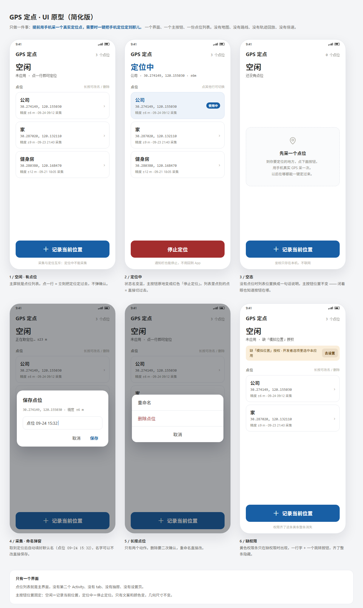

# code3.1 · GPS 定点

`D:\gr\code3\GpsRoam`（录制轨迹 → 回放）的**定点简化版**。
只做一件事：**提前用手机采一个真实定位点，需要时一键把手机定位定到那儿。**

- 工程：[`GpsPoint/`](GpsPoint)
- 使用说明 / 构建 / 能力边界：[`GpsPoint/README.md`](GpsPoint/README.md)
- UI 设计稿（先做的那一步）：[`GpsPoint/UI设计.md`](GpsPoint/UI设计.md) · 高保真原型 [`GpsPoint/ui-prototype/index.html`](GpsPoint/ui-prototype/index.html)
- 可安装文件（就在本目录）：[`GpsPoint-v1.1.apk`](GpsPoint-v1.1.apk) · 构建产物：[`app-debug.apk`](GpsPoint/app/build/outputs/apk/debug/app-debug.apk)
- 模拟器实拍：[`GpsPoint/screenshots/`](GpsPoint/screenshots)

## 一句话范围

一个界面、一份点位列表、一个位置固定的主按钮。采集与应用互斥：定位中不出现采集入口。
没有地图、路线、轨迹回放、倍速、摇杆、设置页；点位只存本机，App 没有 INTERNET 权限。
